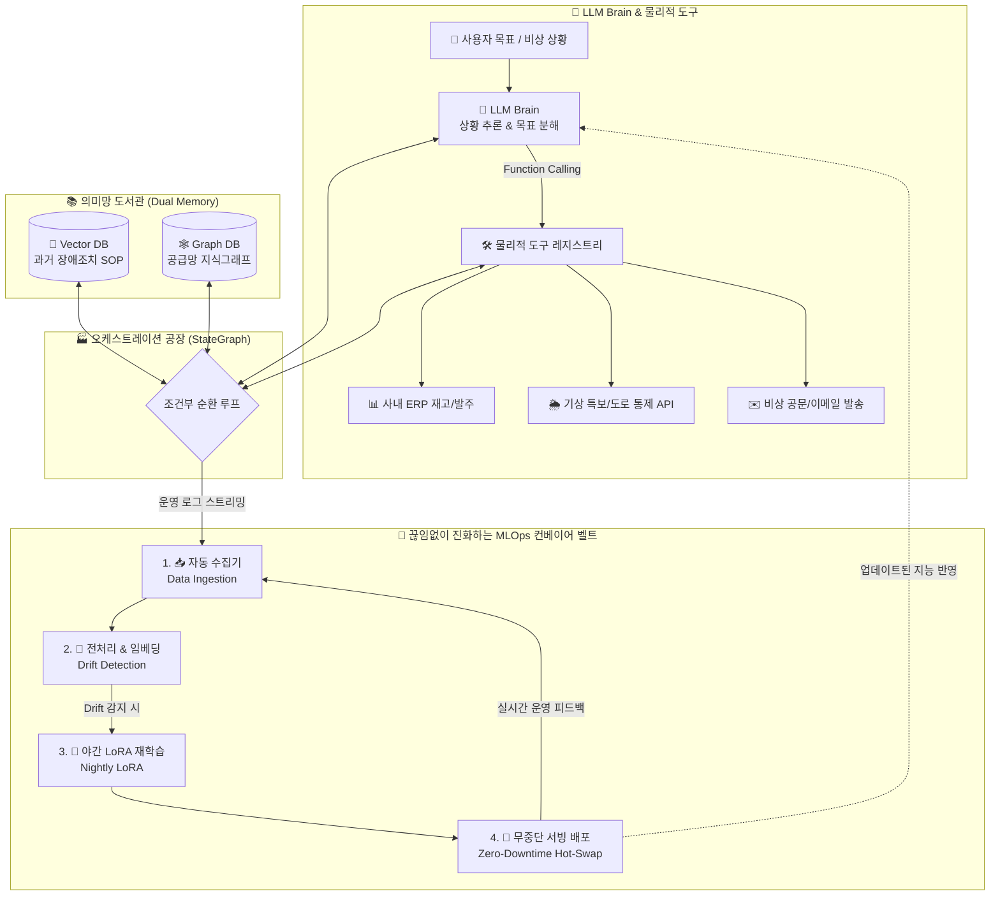

# [제30장 최종 프로젝트 구성 목차]

```
[제30장 최종 프로젝트: 엔터프라이즈 스마트 SCM 자율 AI 에이전트 & 자율 진화 MLOps 플랫폼]
├── 1. 전체적인 개요 및 시스템 아키텍처 흐름 (Mermaid)
├── 2. Colab 노트북 각 셀(Cell 1~6)별 상세 역할
├── 3. 각 코드 한 줄 한 줄(Line-by-line) 초보자용 친절 해설
├── 4. 주요 클래스, 함수 및 파라미터(옵션) 공식 레퍼런스 표
│
├── 🚀 5. [초보자용 vs 실무 작업용 명시]
│   └─ 상단 Colab 노트북: 개념 이해를 위한 초보자용(학습용 원클릭 시뮬레이션)
│   └─ 하단 전체 패키지: 실제 대규모 인프라 배포용 실무 작업용(Production Grade)
│
└── 🏢 6. [실무 작업용] 엔터프라이즈 프로덕션 아키텍처 및 실전 구축 명세서 (README)
    ├─ 📥 실무 코드 다운로드 (GitHub): https://github.com/freefluxkr/dmdg_live/tree/main/total_prj
    ├─ 📦 실무 코드 전체 압축본: https://github.com/freefluxkr/dmdg_live/raw/main/total_prj.zip
    ├─ 🌐 실시간 라이브 관제 대시보드: http://10.0.66.19:8095 (로컬: http://127.0.0.1:8095)
    ├─ 📖 초보자·비전공자를 위한 핵심 용어 및 5대 구성 요소 쉬운 해설
    ├─ 5대 구성 요소 모듈 분리 (brain, tools, memory, orchestrator, mlops)
    ├─ 실제 프로젝트 파일 트리 구조
    └─ CLI 데모, FastAPI 무중단 서빙, 웹 대시보드 3대 실행 가이드
```

---

# 🏭 [실무 작업용] 엔터프라이즈 스마트 SCM 자율 운영 에이전트 & 자율 진화 MLOps 플랫폼

> **"중앙의 지능적 뇌(LLM Brain)와 물리적 도구(Function Calling), 과거 지혜(Vector & Graph Memory), 순환형 오케스트레이션(LangGraph), 그리고 데이터 드리프트를 자율 치유하는 무한 MLOps 컨베이어 벨트의 완성"**

* 📥 **실무 코드 GitHub 다운로드**: <https://github.com/freefluxkr/dmdg_live/tree/main/total_prj>
* 📦 **실무 코드 ZIP 패키지 다운로드**: <https://github.com/freefluxkr/dmdg_live/raw/main/total_prj.zip>
* 🌐 **실시간 라이브 테스트 웹 대시보드**: [http://10.0.66.19:8095](http://10.0.66.19:8095/) (로컬: [http://127.0.0.1:8095](http://127.0.0.1:8095/))
* 💻 **로컬 원본 패키지**: [`c:/DMDG/total_prj.zip`](file:///c:/DMDG/total_prj.zip)

---

## 🌟 1. 시스템 핵심 아키텍처 (Architecture Diagram)



---

## 💡 2. 초보자·비전공자를 위한 핵심 용어 및 개념 쉬운 해설

전문 용어가 낯선 분들도 직관적으로 이해할 수 있도록 일상생활과 기업 업무의 비유를 들어 아주 쉽게 풀어 설명합니다.

### 🏢 1) 엔터프라이즈 스마트 SCM 자율 AI 에이전트 & 자율 진화 MLOps 플랫폼
* **엔터프라이즈(Enterprise)**: 개인이 혼자 사용하는 간단한 토이 프로젝트가 아니라, 수많은 부서와 공장, 협력사가 유기적으로 연결된 **대기업의 대규모 실무 운영 환경**을 뜻합니다.
* **스마트 SCM(Supply Chain Management, 공급망 관리)**: 원자재 구입 ➔ 공장 부품 가공 ➔ 완제품 조립 ➔ 전국 배송으로 이어지는 **기업의 물류 신경망 전체를 실시간 데이터로 최적화**하는 분야입니다.
* **자율 AI 에이전트(Autonomous AI Agent)**: "태풍이 오면 어떡하죠?"라고 물었을 때 그저 말로만 조언하는 챗봇(ChatBot)이 아닙니다. 문제 상황이 발생하면 **스스로 ERP 재고를 조회하고, 기상 특보를 확인한 뒤, 사람이 시키지 않아도 대체 협력사에 긴급 발주서를 전송하고 공장장에게 비상 공문을 보내는 '스스로 일하는 유능한 AI 직원'**입니다.
* **자율 진화 MLOps 플랫폼**: AI도 사람처럼 시간이 지나 시장 환경이나 날씨, 유행이 바뀌면 기존 지식이 낡아 성능이 떨어집니다(이를 데이터 드리프트라 부릅니다). 이를 방지하기 위해 매일 밤 AI가 낮 동안 일어난 새 데이터를 스스로 복습하고 학습하여, **매일 아침 최신 성능으로 스스로 업그레이드되는 무인 진화 시스템**입니다.

---

### 🛠️ 2) 도구 사용 (Function Calling, 펑션 콜링)
* **비유: '말만 하는 앵무새' vs '컴퓨터 마우스와 키보드를 직접 쥐고 일하는 실무 비서'**
* **개념**: 기존의 대화형 AI는 문장을 생성하는 데 그쳤습니다. "재고를 채워줘"라고 부탁하면 "네, 채우겠습니다"라고 글자만 출력할 뿐 실제 재고가 늘어나지 않았습니다.
* **Function Calling의 혁신**: AI에게 실제 회사의 컴퓨터 시스템 버튼(API 함수)을 누를 수 있는 권한을 부여하는 기술입니다.
  - `query_erp_inventory`: ERP 전산망의 재고 버튼을 눌러 실시간 수량을 확인
  - `check_weather_and_routes`: 기상청과 도로교통공사 시스템을 조회하여 통제 여부 확인
  - `create_emergency_purchase_order`: 구매 시스템에 실제로 결재 번호와 수량을 입력해 정식 발주서 발행
  - `send_alert_dispatch`: 공장장과 협력사에 공식 승인 공문 이메일 즉시 발송

---

### 📚 3) 의미망 도서관 (Vector DB & Graph DB)
사람의 뇌가 '직관적 기억'과 '논리적 관계망'을 둘 다 사용하는 것처럼, 두 가지 서로 다른 특화 데이터베이스를 결합하여 완벽한 장기 기억(Long-term Memory)을 구현합니다.

1. **📑 Vector DB (벡터 데이터베이스 - 과거 매뉴얼 및 대응 이력 인출)**:
   - **비유: 어떤 질문을 던져도 숨은 의도를 알아채는 '베테랑 수석 사서'**
   - 글자가 토씨 하나까지 일치하지 않아도 문장의 '의미와 뉘앙스'를 숫자로 변환(임베딩)하여 유사도를 측정합니다.
   - 예: 현장 직원이 "폭우 때문에 길이 끊겼어요!"라고 다급히 외쳐도, AI는 '폭우'라는 단어에만 얽매이지 않고 과거에 저장된 *"기상 악화 시 남해고속도로 우회 및 세종테크 대체 배차 SOP 매뉴얼"* 문서를 0.001초 만에 찾아냅니다.
2. **🕸️ Graph DB (그래프 데이터베이스 - 입체적인 공급망 연결 지도)**:
   - **비유: 전국 도로망과 거래처 인맥이 거미줄처럼 이어진 '입체 네비게이션'**
   - 엑셀 표와 같은 평면적인 데이터는 복잡한 관계를 파악하기 어렵습니다. Graph DB는 "창원공장 ➔ [남해선] ➔ 부산항 ➔ [1차 협력사]"와 같은 관계를 점(노드)과 선(엣지)으로 기억합니다.
   - 남해선이 침수 통제되면, 그래프 지도를 탐색하여 즉시 *"남해선 우회 ➔ 경부선 경유 ➔ 대체 공급사 '세종테크' 활용 가능"*이라는 최적의 대안 연결 경로를 수학적으로 찾아냅니다.

---

### 🏭 4) 오케스트레이션 공장 (LangGraph 스타일 StateGraph)
* **비유: 무조건 직진만 하는 '일방통행 컨베이어' vs 문제 발생 시 뒤로 돌아가 확인하는 '베테랑 총괄 공장장'**
* **개념**: 과거의 단순한 프로그램은 1단계 ➔ 2단계 ➔ 3단계로 무조건 일직선 진행을 했습니다. 만약 2단계에서 문제가 발생하면 프로그램 전체가 에러를 내며 멈춰버렸습니다.
* **StateGraph(상태 머신)의 자율 해결력**:
  - AI는 현재의 진행 상태(State: 현재 재고, 확인된 날씨, 장애 여부)를 수첩에 적어가며 일합니다.
  - [상황 인지] ➔ [도구 실행] ➔ [기억 조회] ➔ [검증]
  - 만약 조회 결과 원래 납품받으려던 경로가 태풍으로 막혔다면? 포기하지 않고 **조건부 순환 루프(Loop)**를 돌아 이전 단계로 되돌아갑니다.
  - 지식그래프를 재검색하여 대체 협력사를 찾고, 자기 수정(Self-Correction)을 거쳐 완벽한 대안을 마련한 후에야 최종 결재를 내립니다.

---

### 🔄 5) MLOps 컨베이어 벨트 (끊임없이 진화하는 무한 루프)
* **비유: 공장이 돌아가는 동안에도 멈추지 않고 스스로 부품을 갈아 끼우는 '무인 자율 정비 시스템'**
* **왜 필요한가요?**: 인공지능을 멋지게 개발해두어도 시간이 흐르면 계절이 바뀌고, 신규 거래처가 생기며, 새로운 형태의 이상 기후가 발생합니다. 이로 인해 과거 데이터로 훈련된 AI의 성능이 저하되는 현상을 **데이터 드리프트(Data Drift)**라고 부릅니다.
* **4단계 무한 진화 루프**:
  1. **📥 1. 자동 수집기 (`mlops/ingestion.py`)**: 낮 동안 AI 에이전트가 업무를 수행하며 발생한 로그, 성공/실패 판정, 새로운 기상 이벤트를 데이터 레이크에 실시간 수집합니다.
  2. **🧹 2. 자동 전처리 & 드리프트 감지 (`mlops/processing.py`)**: 단어 출현 빈도와 데이터 분포를 분석하여 새로운 위험 키워드가 유입되었는지(데이터 드리프트) 판별하고, 새로운 지식을 벡터 DB와 지식그래프에 즉시 업데이트합니다.
  3. **🌙 3. 야간 스케줄러 재학습 (`mlops/nightly_retrain.py`)**: 공장 가동이 한산한 심야 시간에 AI가 오늘 수집된 새 데이터를 복습하여, 모델 전체를 다 바꾸지 않고도 핵심 지능만 쏙 골라 빠르게 업데이트하는 **LoRA(경량 미세조정)**를 수행하고 품질 벤치마크를 검증합니다.
  4. **🚀 4. 무중단 서빙 배포 (`mlops/serving_api.py`)**: 아침 출근 시간에 맞춰 시스템을 재부팅할 필요 없이, 서버 메모리 상에서 1초 만에 최신 AI 두뇌로 갈아 끼우는 **Zero-Downtime 메모리 핫스왑(Hot-Swap)**을 단행하여 365일 무중단 가동을 실현합니다.

---

## 📁 3. 프로젝트 디렉터리 구조

```
c:/DMDG_Jobs/Add_Jobs/total_prj/
├── data/                         # 기초 데이터셋
│   ├── erp_mock.json             # 사내 ERP 재고, 생산라인, 발주 데이터
│   ├── knowledge_corpus.json     # 과거 장애 대응 SOP 매뉴얼 (Vector DB용)
│   └── supply_graph.json         # 공급망 노드 및 엣지 (Graph DB용)
├── brain/                        # LLM 의사결정 뇌
│   ├── __init__.py
│   └── llm_brain.py              # 상황 추론, 목표 분해, Function Calling 인자 생성
├── tools/                        # 물리적 도구 (Function Calling)
│   ├── __init__.py
│   ├── tool_implementations.py   # ERP, 기상청, 비상통보 실제 실행 함수
│   └── tool_registry.py          # LLM 스키마 선언 및 디스패처
├── memory/                       # 의미망 도서관
│   ├── __init__.py
│   ├── vector_store.py           # 고속 텍스트 임베딩 및 장기기억 인출
│   └── graph_store.py            # NetworkX 공급망 지식그래프 분석
├── orchestrator/                 # 오케스트레이션 공장 (StateGraph)
│   ├── __init__.py
│   ├── state_graph.py            # 순환형 상태 머신 엔진
│   └── agent_workflow.py         # 엔드투엔드 위기대응 워크플로우
├── mlops/                        # 끊임없이 진화하는 MLOps 컨베이어 벨트
│   ├── __init__.py
│   ├── ingestion.py              # 1. 자동 수집기 (Data Ingestion)
│   ├── processing.py             # 2. 자동 전처리 & 임베딩, 드리프트 감지
│   ├── nightly_retrain.py        # 3. 야간 LoRA 재학습 & 벤치마크
│   ├── serving_api.py            # 4. 무중단 FastAPI 서빙 & 핫스왑
│   └── conveyor_loop.py          # 4단계 무한 루프 스케줄러
├── total_app.py                  # 올인원 단일 파일 & 하이엔드 엔터프라이즈 관제 대시보드
├── total_prj_colab.ipynb         # Google Colab 원클릭 실행 노트북
├── main.py                       # 전체 시스템 통합 실행기 (CLI & Server)
└── README.md                     # 프로젝트 전체 아키텍처 및 안내서
```

---

## 🚀 4. 실전 실행 및 검증 방법 3가지 (자세한 안내)

비전공자나 초보자도 한 단계씩 따라 하실 수 있도록 3가지 실행 모드의 목적과 방법을 알기 쉽게 정리하였습니다.

### 1) CLI 통합 파이프라인 데모 실행
> **"복잡한 웹 화면 없이, 까만 터미널 콘솔에서 AI 에이전트의 사고 과정과 MLOps 무한 루프를 1초 만에 검증하는 개발자 모드"**

에이전트 자율 의사결정(파트 1)과 MLOps 컨베이어 벨트 4단계 무한 루프(파트 2)를 한 번에 검증합니다:
```bash
python c:\DMDG_Jobs\Add_Jobs\total_prj\main.py
```
* **파트 1: 에이전트 자율 의사결정 검증**
  - "남해안 태풍 상륙으로 창원공장 부품 공급 중단 위기"라는 목표가 주어졌을 때, AI가 스스로 목표를 쪼개고, ERP를 조회하며, 도로 통제를 확인한 뒤, 세종테크로 우회 발주하고 비상 공문을 전송하는 전 과정을 컬러 텍스트로 생생히 출력합니다.
* **파트 2: MLOps 4단계 컨베이어 벨트 무한 루프 검증**
  - 파트 1에서 발생한 위기 대응 로그가 수집기(Ingestion)로 들어가고, 데이터 드리프트가 감지되어 야간 LoRA 재학습을 거친 뒤, 무중단으로 새 가중치가 배포되는 전체 라이프사이클 1회를 즉시 시뮬레이션합니다.

---

### 2) FastAPI 무중단 서빙 플랫폼 구동
> **"사내 ERP나 타 시스템, 모바일 앱에서 우리 AI 에이전트를 원격으로 호출할 수 있는 표준 엔터프라이즈 백엔드 API 서버"**

```bash
python c:\DMDG_Jobs\Add_Jobs\total_prj\main.py --serve
```
* **Swagger 대화형 API 문서**: `http://127.0.0.1:8092/docs` (웹에서 직접 API를 클릭해 테스트 가능)
* **시스템 헬스체크**: `http://127.0.0.1:8092/health` (실시간 가동 상태 및 현재 탑재된 모델 버전 확인)
* **에이전트 추론 엔드포인트**: `POST /v1/orchestrate` (비상 상황 텍스트를 전송하면 AI가 실시간 해결)
* **MLOps 무한 루프 1회 강제 트리거**: `POST /v1/mlops/trigger_cycle` (서버 재부팅 없이 즉시 핫스왑 단행)

---

### 3) 하이엔드 엔터프라이즈 관제 대시보드 웹 실행 (적극 추천!)
> **"마우스 클릭만으로 비상 상황을 트리거하고, AI의 뇌 신경망과 공급망 지식그래프가 실시간으로 살아서 움직이는 모습을 관제하는 미래형 웹 관제탑"**

```bash
python c:\DMDG_Jobs\Add_Jobs\total_prj\total_app.py --port 8095
```
* 🖥️ **내 컴퓨터에서 직접 열기 (로컬 접속)**:  
  👉 [http://127.0.0.1:8095](http://127.0.0.1:8095)
* 📱 **스마트폰, 태블릿, 다른 PC에서 원격 접속 (실제 원격 라이브 테스트 URL)**:  
  👉 [http://10.0.66.19:8095](http://10.0.66.19:8095)  
  *(현재 백그라운드에서 `0.0.0.0`으로 상시 가동 중이므로, 동일 공유기/네트워크에 연결된 기기에서 바로 접속하여 테스트하실 수 있습니다!)*

---

*작성일시: 2026-10-14 | DMDG 자율 에이전트 엔지니어링 본부*
