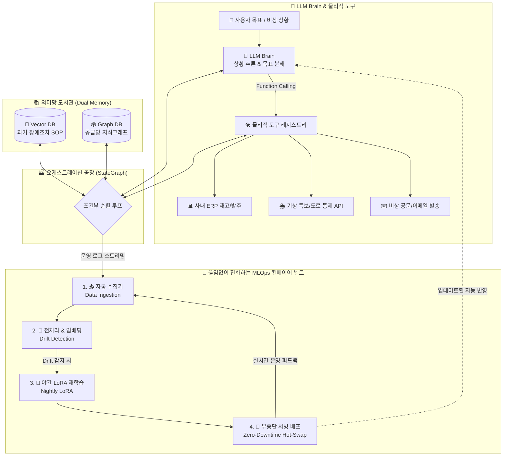

# 📚 당목담글(DMDG) 공식 위키독스(WikiDocs) 연재 도서관

<div align="center">

[](https://dmdg.wikidocs.net/)
[](https://dmdg.wikidocs.net/)
[](https://malssam.com/)

### 🌟 "실무 파이썬 소스코드에 대한 상세한 이론 해설 및 실전 MLOps 아키텍처 명세서는 위키독스 공식 도서관에서 100% 무료로 열람하실 수 있습니다!"

</div>

| 도서명 | 공식 위키독스 링크 | 핵심 수록 내용 및 실습 소스코드 매핑 |
| :--- | :---: | :--- |
| 📘 **《AI 와 데이터 분석 & 최신 LLM 에이전트 완벽 정복을 위한 사전 학습 (수학·기초 엔지니어링)》** | [👉 **Book 21701 바로가기**](https://wikidocs.net/book/21701) | 선형대수학, 역전파, AdamW, Attention 행렬 연산 등 AI 필수 수학 20일 완성 & 파이썬 구현체 |
| 🤖 **《실전 LLM 서비스 & 멀티 에이전트 완벽 마스터북》** | [👉 **Book 21695 바로가기**](https://wikidocs.net/book/21695) | Google Gemini 2.5, GPT-4o, LangChain, LangGraph, ChatDev 멀티 에이전트 협업 & 18종 단독 시뮬레이터 |
| 📊 **《AI 와 데이터 분석 - 22대 핵심 실무 마스터》** | [👉 **Book 21658 바로가기**](https://wikidocs.net/book/21658) | CNN, LSTM, XGBoost, LightGBM, Transformer 실무 머신러닝/딥러닝 22개 챕터 주피터 노트북 |
| 🌐 **당목담글(DMDG) 공식 브랜드 홈** | [👉 **dmdg.wikidocs.net 바로가기**](https://dmdg.wikidocs.net/) | 전 도서 통합 포털, 20종 실시간 시뮬레이터 허브, 라이브 서비스 관제 센터 |

---

# [제30장 최종 프로젝트 구성 목차]

```
[제30장 최종 프로젝트: 엔터프라이즈 스마트 SCM 자율 AI 에이전트 & 자율 진화 MLOps 플랫폼]
├── 1. 전체적인 개요 및 시스템 아키텍처 흐름 (Mermaid)
├── 2. Colab 노트북 각 셀(Cell 1~6)별 상세 역할
├── 3. 각 코드 한 줄 한 줄(Line-by-line) 초보자용 친절 해설
├── 4. 주요 클래스, 함수 및 파라미터(옵션) 공식 레퍼런스 표
│
├── 🚀 5. [초보자용 vs 실무 작업용 명시]
│   └─ 상단 Colab 노트북: 개념 이해를 위한 초보자용(학습용 원클릭 시뮬레이션)
│   └─ 하단 전체 패키지: 실제 대규모 인프라 배포용 실무 작업용(Production Grade)
│
└── 🏢 6. [실무 작업용] 엔터프라이즈 프로덕션 아키텍처 및 실전 구축 명세서 (README)
    ├─ 📥 실무 코드 다운로드 (GitHub ZIP): https://github.com/freefluxkr/dmdg_live/raw/main/total_prj.zip
    ├─ 📁 실무 코드 저장소 폴더 (GitHub): https://github.com/freefluxkr/dmdg_live/tree/main/total_prj
    ├─ 🌐 실시간 라이브 관제 대시보드: http://10.0.66.19:8095 (로컬: http://127.0.0.1:8095)
    ├─ 📖 비전공자를 위한 7대 필수 IT·AI 핵심 용어 사전 (하이엔드, 트리거, LoRA, CLI, MLOps, 드리프트, 서빙)
    ├─ 💡 5대 핵심 지능 아키텍처 (LLM Brain, Function Calling, Dual Memory, StateGraph, Conveyor)
    ├─ 📂 실제 프로젝트 파일 트리 구조
    └─ 🚀 CLI 데모, FastAPI 무중단 서빙, 웹 관제 대시보드 3대 실행 가이드
```

---

# 🏭 [실무 작업용] 엔터프라이즈 스마트 SCM 자율 운영 에이전트 & 자율 진화 MLOps 플랫폼

> **"중앙의 지능적 뇌(LLM Brain)와 물리적 도구(Function Calling), 과거 지혜(Vector & Graph Memory), 순환형 오케스트레이션(LangGraph), 그리고 데이터 드리프트를 자율 치유하는 무한 MLOps 컨베이어 벨트의 완성"**

* 📦 **실무 코드 ZIP 패키지 다운로드 (GitHub)**: <https://github.com/freefluxkr/dmdg_live/raw/main/total_prj.zip>
* 📥 **실무 코드 GitHub 소스 폴더**: <https://github.com/freefluxkr/dmdg_live/tree/main/total_prj>
* 🌐 **실시간 라이브 테스트 웹 대시보드**: [http://10.0.66.19:8095](http://10.0.66.19:8095/) (로컬: [http://127.0.0.1:8095](http://127.0.0.1:8095/))
* ⚡ **초고속 웹 직접 다운로드 (404 없는 실시간 링크)**: [http://10.0.66.19:8095/download/total_prj.zip](http://10.0.66.19:8095/download/total_prj.zip)
* 💻 **로컬 원본 패키지**: [`c:/DMDG/total_prj.zip`](file:///c:/DMDG/total_prj.zip) (63.2 KB)

---

## 🌟 1. 시스템 핵심 아키텍처 (Architecture Diagram)



---

## 📚 2. 비전공자·초보자를 위한 7대 필수 IT·AI 핵심 용어 사전

비전공자도 일상생활의 비유를 통해 직관적으로 무릎을 탁 칠 수 있도록 명쾌하게 설명합니다.

### 💎 1) 하이엔드 (High-End)
* **일상 비유: '기본 기능만 있는 일반 승용차' vs '최첨단 관제 시스템이 탑재된 최고급 플래그십 슈퍼카'**
* **의미**: IT 및 소프트웨어 분야에서 '하이엔드'는 기본 작동만 간신히 되는 조잡한 토이 프로젝트가 아니라, **디자인·보안·성능·안정성·인프라 확장성 모든 면에서 대기업 프로덕션 레벨의 최상위 완성도를 갖춘 시스템**을 뜻합니다.
* **이 프로젝트의 하이엔드 요소**: 단순한 까만 콘솔 텍스트 출력을 넘어, 주식 트레이딩 룸이나 NASA 우주선 관제 센터처럼 다크모드 글래스모피즘, 실시간 SVG 네트워크 지도, 동적 ERP 장부 게이지, MLOps 파이프라인 애니메이션이 완비된 미래형 웹 인터페이스를 제공합니다.

---

### 🎯 2) 트리거 (Trigger)
* **일상 비유: '권총의 방아쇠를 당기다' / '도미노의 첫 번째 블록을 툭 치다'**
* **의미**: 권총의 방아쇠(Trigger)를 손가락으로 당기면 총알이 자동으로 튀어나가듯, **특정 조건이나 사건이 일어났을 때 다음 단계의 프로그램이나 작업들이 줄줄이 연쇄적으로 자동 실행되도록 신호를 보내는 행위나 버튼**을 의미합니다.
* **이 프로젝트에서 쓰이는 곳**:
  - **위기 상황 트리거**: 웹 대시보드에서 `[비상 상황 트리거]` 버튼을 클릭하면, AI 에이전트의 상황 추론과 도구 호출이 방아쇠를 당긴 것처럼 즉시 연쇄 시작됩니다.
  - **MLOps 재학습 트리거**: 데이터 드리프트(새로운 이상 기후 단어)가 감지되는 순간, 백그라운드 스케줄러가 방아쇠를 당겨 야간 재학습 파이프라인을 자동 가동합니다.

---

### ⚡ 3) LoRA (로라, Low-Rank Adaptation)
* **일상 비유: '백과사전 전집 50권을 매일 새로 인쇄하기' vs '오늘 새로 바뀐 내용만 포스트잇에 적어 책장 맨 앞에 붙여두기'**
* **의미**: ChatGPT나 DeepSeek 같은 거대 언어 모델(LLM)은 뇌 세포(파라미터)가 수백억 개에 달해, 매일 새로운 지식을 통째로 가르치려면 수억 원의 전기세와 거대한 슈퍼컴퓨터가 필요합니다(풀 파인튜닝).
* **LoRA의 마법**:
  - 거대한 기존 AI 두뇌 본체는 그대로 얼려두고(Freeze), **오늘 새롭게 발생한 지식(예: 이번 태풍 우회로, 세종테크 발주서 양식)만 얇고 가벼운 어댑터(포스트잇) 형태로 초고속 학습**시키는 최첨단 경량 미세조정 기술입니다.
  - 모델 용량이 수 기가바이트(GB)가 아니라 수 메가바이트(MB) 수준으로 가벼워져, **단 3초 만에 AI를 최신 지능으로 탈바꿈**시킵니다.

---

### 💻 4) CLI (Command Line Interface, 커맨드 라인 인터페이스)
* **일상 비유: '마우스로 예쁜 아이콘 더블클릭하기(GUI)' vs '영화 속 천재 해커처럼 검은 화면에 글자로 명령어 치기(CLI)'**
* **의미**:
  - 우리가 흔히 쓰는 윈도우 창, 마우스 커서, 스마트폰 터치스크린 환경을 **GUI (Graphical User Interface)**라고 부릅니다.
  - 반면, **CLI**는 화려한 그래픽 없이 **까만 글자 창(터미널, CMD, 파워쉘)에 키보드로 명령어를 직접 타이핑(`python main.py`)하여 컴퓨터를 실행하고 조종하는 방식**입니다.
* **왜 쓸까요?**: 그래픽을 띄우지 않아 속도가 번개처럼 빠르고 컴퓨터 메모리를 거의 쓰지 않으며, 서버 컴퓨터나 무인 자동화 환경에서 가장 신뢰성이 높기 때문입니다.

---

### 🔄 5) MLOps (머신러닝 오퍼레이션, Machine Learning + Operations)
* **일상 비유: '음식점 주방에서 신메뉴 요리 레시피 개발하기(ML)' + '매일 신선한 재료를 자동 배송받고 주방 청소하고 홀에 서빙하는 식당 무인 경영 시스템(Ops)'**
* **의미**:
  - 머신러닝(ML) 연구원은 연구실에서 AI 모델 하나를 멋지게 만드는 데 집중합니다.
  - 하지만 이를 실제 공장이나 기업에 도입하면(Operations), 날씨도 바뀌고 거래처도 바뀌며, 서버가 멈출 수도 있습니다.
  - **MLOps**는 **데이터 수집 ➔ 전처리 ➔ 학습 ➔ 성능 검증 ➔ 실제 무중단 서빙 배포 ➔ 실시간 감시**에 이르는 전 과정을 사람 손을 타지 않고 **공장의 무한 컨베이어 벨트처럼 100% 무인 자동화로 굴러가게 만드는 총괄 운영 공학**입니다.

---

### 🌊 6) 드리프트 (Drift - 데이터 드리프트 & 컨셉 드리프트)
* **일상 비유: '여름 바캉스 옷 입는 법만 완벽히 배운 AI'에게 '갑자기 영하 15도 북극 한파가 들이닥쳤을 때의 멘붕'**
* **의미**: 영어 단어 Drift는 배가 거친 물살에 밀려 원래 항로에서 '스르륵 표류하여 빗나가는 것'을 뜻합니다.
* **AI 세상에서의 드리프트**:
  - AI를 과거 데이터로 아무리 똑똑하게 훈련시켜 두어도, 시간이 흐르면 **현실 세계의 날씨, 유행어, 신규 협력사, 도로 통제 현황이 스르륵 변해버립니다.**
  - 예: 과거 매뉴얼에는 "부산항 침수 시 1차 협력사로 가라"고 되어 있었는데, 현실에선 1차 협력사마저 물에 잠겼다면? AI가 옛날 지식에 갇혀 엉뚱한 결정을 내리게 됩니다.
  - 이를 **데이터 드리프트**라고 부르며, 우리 시스템은 이 드리프트를 감시 레이더로 실시간 감지하여 AI를 즉각 야간 자율 재학습시킵니다.

---

### 🍽️ 7) 서빙 (Serving)
* **일상 비유: 주방에서 정성껏 조리한 따끈따끈한 음식을 손님 테이블 위에 내놓는 행위**
* **의미**:
  - 개발자의 컴퓨터 하드디스크 속에 AI 모델 파일(`.py`, `.json`, `.pt`)이 얌전하게 저장되어 있는 것은 '주방에 보관된 요리'와 같습니다.
  - **서빙(Serving)**이란, 완성된 AI 모델을 네트워크 웹 서버(FastAPI 등)에 올려놓고, **스마트폰 앱, 카카오톡, 사내 ERP, 전국 공장 컴퓨터 등 어디서든 인터넷 주소(URL)로 접속해 질문을 던지고 1초 만에 실시간 답변을 받아갈 수 있도록 서비스를 제공하는 상태**를 뜻합니다.

---

## 💡 3. 시스템 5대 핵심 지능 아키텍처 명세

### 1. 🧠 LLM Brain (중앙 의사결정 두뇌)
* **역할**: 비정형 텍스트 목표를 다단계 하위 목표(Goal Decomposition)로 분해하고, 어떤 도구와 지식이 필요한지 자율 판단.
* **구현**: [`brain/llm_brain.py`](file:///c:/DMDG_Jobs/Add_Jobs/total_prj/brain/llm_brain.py)

### 2. 🛠️ 도구 사용 (Function Calling, 펑션 콜링)
* **역할**: 단순 말대꾸를 넘어, 사내 ERP 데이터베이스를 직접 수정하고 실제 외부 API를 호출하는 손과 발의 역할.
* **구현**: [`tools/tool_implementations.py`](file:///c:/DMDG_Jobs/Add_Jobs/total_prj/tools/tool_implementations.py), [`tools/tool_registry.py`](file:///c:/DMDG_Jobs/Add_Jobs/total_prj/tools/tool_registry.py)

### 3. 📚 의미망 도서관 (Vector & Graph DB)
* **역할**: 장기 기억(Long-term Memory) 인출 및 복잡한 공급망 관계망 추론.
* **구현**: 
  - [`memory/vector_store.py`](file:///c:/DMDG_Jobs/Add_Jobs/total_prj/memory/vector_store.py): 과거 태풍/폭우 시 SCM 우회 매뉴얼 코사인 유사도 검색
  - [`memory/graph_store.py`](file:///c:/DMDG_Jobs/Add_Jobs/total_prj/memory/graph_store.py): NetworkX 공급망 지식그래프로 대체 공급사(세종테크) 및 안전 운송 경로(경부선) 즉시 도출

### 4. 🏭 오케스트레이션 공장 (LangGraph 스타일 StateGraph)
* **역할**: 일자형 파이프라인의 한계를 극복하고, 상황에 따라 도구 실행 ➔ 기억 인출 ➔ 검증 ➔ 자기 수정(Self-Correction)을 반복하는 조건부 순환 루프.
* **구현**: [`orchestrator/state_graph.py`](file:///c:/DMDG_Jobs/Add_Jobs/total_prj/orchestrator/state_graph.py), [`orchestrator/agent_workflow.py`](file:///c:/DMDG_Jobs/Add_Jobs/total_prj/orchestrator/agent_workflow.py)

### 5. 🔄 끊임없이 진화하는 MLOps 컨베이어 벨트 (무한 루프)
* **1. 자동 수집기 (`mlops/ingestion.py`)**: 현장 운영 로그, 에이전트 실패/성공 판정 스트리밍 적재.
* **2. 자동 전처리 및 임베딩 (`mlops/processing.py`)**: 데이터 드리프트 감지 및 지식그래프 증분 반영.
* **3. 야간 스케줄러 재학습 (`mlops/nightly_retrain.py`)**: 야간 비동기 LoRA 미세조정 및 벤치마크 검증.
* **4. 무중단 서빙 배포 (`mlops/serving_api.py`)**: FastAPI 기반 **Zero-Downtime 메모리 핫스왑(Hot-Swap)** 프로덕션 배포.

---

## 📁 4. 프로젝트 디렉터리 구조

```
c:/DMDG_Jobs/Add_Jobs/total_prj/
├── data/                         # 기초 데이터셋
│   ├── erp_mock.json             # 사내 ERP 재고, 생산라인, 발주 데이터
│   ├── knowledge_corpus.json     # 과거 장애 대응 SOP 매뉴얼 (Vector DB용)
│   └── supply_graph.json         # 공급망 노드 및 엣지 (Graph DB용)
├── brain/                        # LLM 의사결정 뇌
│   ├── __init__.py
│   └── llm_brain.py              # 상황 추론, 목표 분해, Function Calling 인자 생성
├── tools/                        # 물리적 도구 (Function Calling)
│   ├── __init__.py
│   ├── tool_implementations.py   # ERP, 기상청, 비상통보 실제 실행 함수
│   └── tool_registry.py          # LLM 스키마 선언 및 디스패처
├── memory/                       # 의미망 도서관
│   ├── __init__.py
│   ├── vector_store.py           # 고속 텍스트 임베딩 및 장기기억 인출
│   └── graph_store.py            # NetworkX 공급망 지식그래프 분석
├── orchestrator/                 # 오케스트레이션 공장 (StateGraph)
│   ├── __init__.py
│   ├── state_graph.py            # 순환형 상태 머신 엔진
│   └── agent_workflow.py         # 엔드투엔드 위기대응 워크플로우
├── mlops/                        # 끊임없이 진화하는 MLOps 컨베이어 벨트
│   ├── __init__.py
│   ├── ingestion.py              # 1. 자동 수집기 (Data Ingestion)
│   ├── processing.py             # 2. 자동 전처리 & 임베딩, 드리프트 감지
│   ├── nightly_retrain.py        # 3. 야간 LoRA 재학습 & 벤치마크
│   ├── serving_api.py            # 4. 무중단 FastAPI 서빙 & 핫스왑
│   └── conveyor_loop.py          # 4단계 무한 루프 스케줄러
├── total_app.py                  # 올인원 단일 파일 & 하이엔드 엔터프라이즈 관제 대시보드
├── total_prj_colab.ipynb         # Google Colab 원클릭 실행 노트북
├── main.py                       # 전체 시스템 통합 실행기 (CLI & Server)
└── README.md                     # 프로젝트 전체 아키텍처 및 안내서
```

---

## 🚀 5. 실전 실행 및 검증 방법 3가지

### 1) CLI 통합 파이프라인 데모 실행
에이전트 자율 의사결정(파트 1)과 MLOps 컨베이어 벨트 4단계 무한 루프(파트 2)를 한 번에 검증합니다:
```bash
python c:\DMDG_Jobs\Add_Jobs\total_prj\main.py
```

### 2) FastAPI 무중단 서빙 플랫폼 구동
```bash
python c:\DMDG_Jobs\Add_Jobs\total_prj\main.py --serve
```
* **Swagger 대화형 API 문서**: `http://127.0.0.1:8092/docs`
* **시스템 헬스체크**: `http://127.0.0.1:8092/health`
* **에이전트 추론 엔드포인트**: `POST /v1/orchestrate`
* **MLOps 무한 루프 1회 강제 트리거**: `POST /v1/mlops/trigger_cycle`

### 3) 하이엔드 엔터프라이즈 관제 대시보드 웹 실행 (적극 추천!)
```bash
python c:\DMDG_Jobs\Add_Jobs\total_prj\total_app.py --port 8095
```
* 📱 **스마트폰, 태블릿, 다른 PC에서 원격 접속 (실제 원격 라이브 테스트 URL)**:  
  👉 **<http://10.0.66.19:8095>**
* 🖥️ **내 컴퓨터에서 직접 열기 (로컬 접속)**:  
  👉 [http://127.0.0.1:8095](http://127.0.0.1:8095)
* 📥 **실시간 ZIP 직접 다운로드**:  
  👉 [http://10.0.66.19:8095/download/total_prj.zip](http://10.0.66.19:8095/download/total_prj.zip)

---

*작성일시: 2026-10-14 | DMDG 자율 에이전트 엔지니어링 본부*
